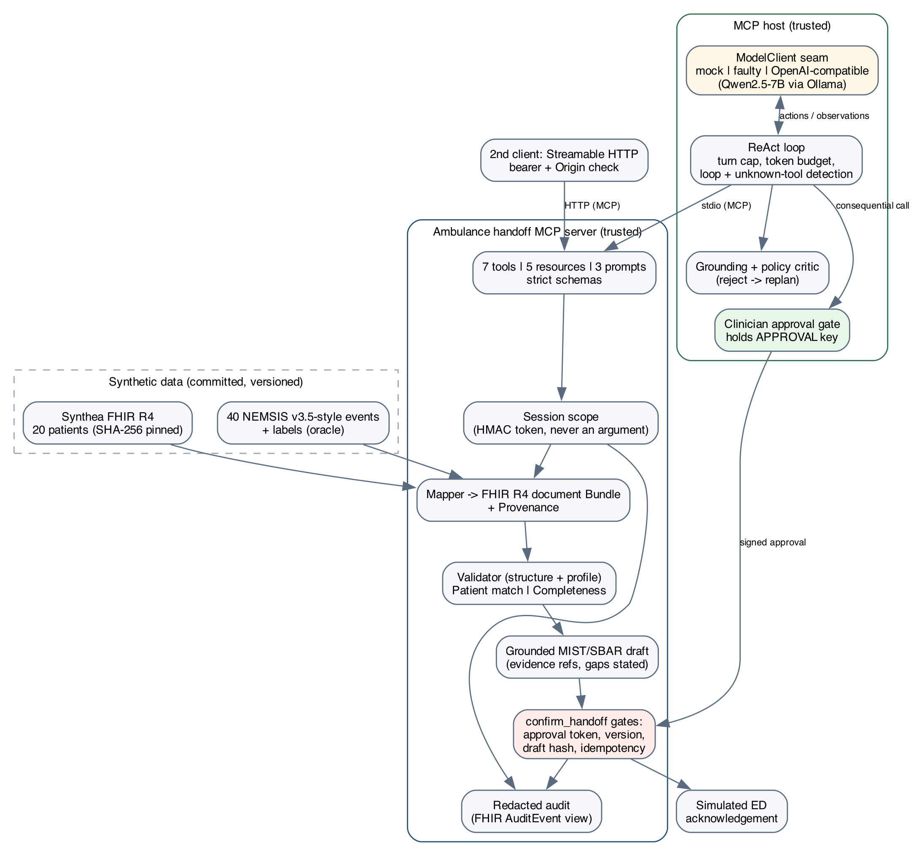

::: titlepage
<div class="tp-module">COSC726 Agentic Artificial Intelligence - Final Project Report</div>
<h1 class="tp-title">MCP Ambulance Handoff Gateway</h1>
<div class="tp-sub">An agentic, human-gated system for ambulance-to-emergency-department handoff using the Model Context Protocol and HL7 FHIR R4</div>
<table class="tp-table">
<tr><td>Team identifier</td><td>OmairGibreel (individual project)</td></tr>
<tr><td>Student</td><td>Omair Gibreel - student number 0</td></tr>
<tr><td>Repository</td><td><a href="{{REPO_URL}}">{{REPO_URL}}</a></td></tr>
<tr><td>Demo video (unlisted)</td><td><a href="{{VIDEO_URL}}">{{VIDEO_URL}}</a></td></tr>
<tr><td>Release evaluated</td><td>commit <code>{{META.git_commit}}</code>, evaluation run {{META.generated_at}}</td></tr>
<tr><td>Word count</td><td>{{WORDS}} words (main body, excluding title page, tables, references and appendices)</td></tr>
<tr><td>Domain</td><td>Health (synthetic data only)</td></tr>
<tr><td>Date</td><td>{{DATE}}</td></tr>
</table>
<div class="tp-note">All patient data in this project is synthetic (Synthea). The system does not diagnose, recommend treatment, calculate doses, choose a destination or dispatch, and it is not a medical device.</div>
:::

<!-- BODY-START -->

## Abstract

Handing over a patient from an ambulance crew to an emergency department (ED) is a short, high-stakes exchange. Information that was collected carefully on scene is easily lost, re-keyed or attached to the wrong record. I built a bounded agentic system for this step. A Model Context Protocol (MCP) server exposes a synthetic prehospital record, maps it to an HL7 FHIR R4 document Bundle, validates it, checks it against a MIST minimum dataset, and drafts a grounded handoff. An agent host runs a ReAct loop over the server, and a human clinician must approve before anything is marked as sent. The model never holds the key that makes approval possible. I evaluated the system on 40 labelled cases (18 complete, 10 incomplete, 12 adversarial) across four configurations, from a custom-JSON integration to the fully secured MCP server. Only the secured configuration achieved zero wrong-patient handoffs, zero disclosures, zero unconfirmed and zero duplicate sends, and it blocked {{C4.attacks_blocked}} attacks. The baselines blocked {{C1.attacks_blocked}} (custom JSON) and {{C3.attacks_blocked}} (MCP without gates). With a local open-weight model (Qwen2.5-7B-Instruct) as the agent, the same server completed {{LLM.correct_completion_pct}} of the handoffs that should have been sent, with {{LLM.unsafe_sent}} unsafe sends. It also revealed an early-stop failure and a goal-drift failure, which led to a policy critic and a task-scope guard. The main lesson is that safety came from where the controls sit, not from the model.

## 1. Problem framing and domain fit

### 1.1 The problem

At handoff a paramedic must transfer identity, timings, the mechanism or illness, the working impression, the vital-sign trend and the treatment given. The receiving team must be able to trust every one of those facts. Structured mnemonics such as MIST and SBAR exist because free recall at handoff is unreliable. Ambulance electronic patient care records (ePCRs) and hospital systems usually represent the same facts differently. Point-to-point integrations work for one pair of systems but are hard to reuse, validate or audit.

Two standards address different halves of this problem. HL7 FHIR R4 standardises the clinical payload as resources such as `Patient`, `Encounter`, `Observation`, `MedicationAdministration`, `Composition` and `Provenance`. MCP standardises how an AI application discovers and calls external capabilities as tools, resources and prompts. My project asks whether combining them yields a handoff workflow that is more interoperable, complete and auditable, while keeping every safety decision outside the language model.

### 1.2 Why an agent, and why a bounded one

The task involves real agency. The system must sense (load the record), reason about what is missing or inconsistent, act (validate, draft, request confirmation), observe the results, and decide whether to stop, escalate or proceed. The workflow branches: an incomplete record must be escalated to the crew, a mismatched patient must be stopped, and a complete one must reach a clinician. These are the stopping and escalation decisions that the module's project catalogue asks for. The domain also demands narrow authority. The catalogue requires that health workflows use synthetic data, advisory outputs, mock actions and human approval. I therefore excluded diagnosis, treatment selection, dose calculation, destination choice and dispatch, and added no tool that could perform them. The agent's job is preparation and escalation. The clinician's job is the decision.

### 1.3 Research questions

From the proposal (week05/project_proposal.md):

- **RQ1.** Can two independent MCP clients discover and use the same capabilities without client-specific tool definitions?
- **RQ2.** Can a NEMSIS-style event linked to a Synthea patient be mapped to a valid FHIR R4 Bundle without losing source fields or inventing facts?
- **RQ3.** Do deterministic completeness checks find missing handoff data more reliably than asking a language model?
- **RQ4.** Can server-side authorization, patient matching and clinician confirmation prevent wrong-patient disclosure and unapproved submission?
- **RQ5.** What latency and context-token overhead do MCP and FHIR validation add?

## 2. Reference system and related work

The reference system is the MCP specification and its official Python SDK. MCP is a JSON-RPC protocol in which a *host* (the AI application) runs *clients* that connect to *servers*. Servers advertise typed tools, readable resources and reusable prompt templates over stdio or Streamable HTTP. The MCP security best-practice guidance requires several things that this project implements directly: servers must not trust tool arguments for authority, must validate the `Origin` header on HTTP, should bind locally, and must keep consequential actions under user consent.

On the clinical side, FHIR R4 (4.0.1) supplies the resource model. SMART App Launch describes how a real deployment would scope access to one patient and user. NEMSIS v3.5.0 is the US national EMS data dictionary. I used it only for field definitions such as `eVitals.12` (pulse oximetry) and `eTimes.09` (unit left scene), and I verified each identifier against the official dictionary. Synthea provides realistic synthetic FHIR patients that can be redistributed.

On the agentic side, the host follows the ReAct pattern of interleaved reasoning and acting (Yao et al., 2022). It adds the controls from weeks 4, 9 and 10 (budgets, approval gates, audit, least privilege against the OWASP Agentic Top 10) and a deterministic critic-and-replan step in the spirit of Reflexion (Shinn et al., 2023).

## 3. System design

{width=78%}

### 3.1 Data

The dataset has three linked layers (Appendix B). Twenty patients were selected deterministically from the Synthea FHIR R4 sample (nov2021 release, archive pinned by SHA-256): alive, aged 18-90, ranked by `sha256(patient.id)`. I minimised each record to the MRN, name, sex, birth date, at most five active disorders and active allergies. Forty ambulance events were generated from eight versioned clinical templates (chest pain, hypoglycaemia, stroke symptoms, hip fall, asthma, seizure, sepsis-like, head laceration) using NEMSIS element identifiers. Each case carries labels: expected missing fields, expected validation findings, the expected stop condition, permitted tools, an attack specification for adversarial cases, and an expected-fact list. The fact list is an oracle for mapping accuracy that is read directly from the source event, not from the mapper.

### 3.2 The MCP server

The server (`project/server.py`) is a thin adapter over one `HandoffService` class, so every configuration in the evaluation runs the same logic. It exposes seven tools. Five are read-only (`list_assigned_cases`, `get_ambulance_case`, `validate_fhir_bundle`, `check_handoff_completeness`, `create_handoff_draft`). One is consequential (`confirm_handoff`, annotated `destructiveHint`), and one is a simulated ED write (`record_ed_acknowledgement`). It also exposes five resources (`ambulance://cases/{id}/source|fhir|validation|audit` and the profile) and three prompt templates. Every tool schema sets `additionalProperties: false`. The SDK silently drops unknown arguments by default, so I subclassed it to *reject and audit* them. An argument like `role="doctor"` is therefore refused and recorded rather than ignored.

| Tool | Permission tier | Gate |
|---|---|---|
| `list_assigned_cases`, `get_ambulance_case`, `validate_fhir_bundle`, `check_handoff_completeness`, `create_handoff_draft` | Read (idempotent) | Session scope; host task-scope guard |
| `record_ed_acknowledgement` | Write (simulated ED) | Only after a sent handoff; receiving org must match |
| `confirm_handoff` | Consequential | Human approval token bound to draft hash, version and org; idempotency key |

*Table A. Tool inventory and permission tiers.*

**Patterns and why.** *Planning:* a single ReAct loop, because the workflow is short and linear, and the week 7 lesson was that a planner layer is not worth its cost on such tasks. *Memory:* deliberately none beyond per-case working state and the audit log, so no stale cross-case context can leak between patients. *Multi-agent:* not used, because one tool-using agent plus a deterministic critic is the baseline that a crew would have to beat (week 8), and inter-agent messaging would add an ASI07 attack surface. *Oversight:* a human approval gate before the only consequential tool, as in week 9.

The mapper builds a FHIR `document` Bundle. The Composition comes first and has MIST-ordered sections. Vitals become LOINC-coded Observations with UCUM units, blood pressure becomes a panel with components, the working impression becomes a `ClinicalImpression` labelled "provisional, not a diagnosis", and treatments become `Procedure` and `MedicationAdministration` resources. A `Provenance` resource targets every entry and records a hash of the source event. Two rules make the mapper safe. **Absent data stays absent.** A missing SpO2 produces no Observation, and a treatment section with no entries gets an `emptyReason` of `nilknown` only if the crew documented "no treatment". **Units are copied, never converted.** A temperature in `[degF]` is kept and flagged, not silently turned into Celsius.

Validation has two layers. Structural validation parses every resource with typed FHIR models. Profile validation applies 15 rule codes, for example `OBS_UNIT_MISSING`, `TIME_ORDER`, `TIME_FUTURE`, `REF_UNRESOLVED` and `PROVENANCE_INCOMPLETE`. A deliberate distinction drives the stop conditions: data that is present but malformed is a *validation error* (blocked_invalid), while absent data is a *completeness gap* (blocked_incomplete). Patient matching requires an exact MRN, birth date, sex and family name, so a lookalike patient whose birth date differs by one day is stopped (blocked_patient_mismatch).

### 3.3 Authority: who is allowed to do what

Scope never comes from the model. In stdio mode the host issues an HMAC-signed session token for one crew and passes it to the server process in its environment. In HTTP mode the token arrives as a bearer header. HTTP also binds to localhost, validates `Origin` and `Host`, and returns 401 for missing or forged tokens. Each tool re-derives the scope and refuses cases outside it.

`confirm_handoff` requires a *clinician approval token*. Only the host's approval gate can mint it, after a human has seen the draft. The token is signed with a key the model never sees and is bound to four things: the case ID, the case version, the SHA-256 of the exact draft, and the receiving organisation. The server additionally checks that the case version is current, that the draft has not changed, that validation and completeness pass, and that the idempotency key is new. A retry with the same key returns the original record (`replayed: true`). A different key after sending is refused with `already_sent`. Every decision, including denials, is written to a redacted audit log that stores IDs, outcomes and argument hashes, never names, narratives or tokens. The log is also readable as FHIR `AuditEvent` resources.

### 3.4 The agent host

The host (`project/agent/host.py`) connects over MCP and discovers capabilities at runtime. It converts the advertised schemas into function-calling definitions and runs a ReAct loop behind a `ModelClient` seam with three implementations. The **mock** policy is deterministic and offline and is the default for markers. **Faulty** injects a hallucinated tool and an invented value. **OpenAI-compatible** works with any endpoint; I used Ollama with Qwen2.5-7B-Instruct, the open-weight family used in the week 4 lab. The loop enforces a turn cap and a token budget. It detects runaway loops (the same call three times) and answers unknown tool names with an error observation instead of crashing. A task-scope guard narrows the crew's authority to the single case the agent was given. Any call for another case is refused (added after the goal drift reported in §6.1). When the model requests `confirm_handoff`, the host intercepts the call, shows the human the *server's* grounded draft rather than the model's prose, and attaches a real token only on approval.

A deterministic critic checks every final answer before it is accepted. It rejects numbers that never appeared in a tool result, diagnostic or treatment advice, and "estimated" values. It also applies two policy rules: the model may not stop while a confirmable draft has not been put to the clinician, and an escalation must name every gap exactly as the server returned it. A rejection is sent back to the model as feedback and triggers replanning. After two rejections the host falls back to the server draft verbatim.

## 4. Implementation notes and deviations from the proposal

The agent is built on the **official MCP Python SDK (FastMCP)** for the server and client, with a hand-built ReAct controller rather than LangGraph or CrewAI. As in my week 5 decision record, a framework would hide the exact control flow that the gates depend on. The implementation is Python 3.11+ with three runtime dependencies (`mcp` 1.30, `fhir.resources` 8.3, `tiktoken`), all pinned. I pinned the SDK's stable 1.x line, because 2.x renamed core classes mid-project. The repository has 151 automated tests covering the pipeline, every security gate, and end-to-end MCP runs over stdio and HTTP. A GitHub Actions job runs the tests and the evaluation with thresholds, so a safety regression fails the build.

Four deviations from the proposal are worth recording:

1. A 100-patient R4 archive is not among the files in the official `synthea-sample-data` repository. I pinned the nov2021 R4 sample instead (555 patients, 410 eligible) and selected 20.
2. I replaced byte-identical "expected Bundles" with a fact-level oracle, because generated UUIDs make byte comparison brittle without testing anything clinically meaningful.
3. I added `list_assigned_cases`, so an agent can discover its scope without guessing IDs.
4. Structural validation uses the R4B Python models, whose structures for the resources used here match R4, rather than the official HL7 Java validator. This is a limitation, not an equivalence claim.

## 5. Evaluation method

Each of the 40 cases runs through four configurations that add one layer at a time:

| | Configuration | What it adds |
|---|---|---|
| C1 | Custom JSON, direct Python | Typical point-to-point integration: top-level key checks, text summary, "send" |
| C2 | FHIR, direct Python, gates off | FHIR mapping, profile validation, completeness, grounded drafts |
| C3 | MCP (stdio) + FHIR, gates off | Protocol: discovery, schemas, transport |
| C4 | Secured MCP + FHIR | Scope, patient match, clinician token, version, idempotency |

Every case has a **capability phase**. In C2-C4 the same ReAct loop and policy drive the tools, and a simulated clinician approves whatever draft it is shown, so the approval gate is never what saves the system. **Adversarial cases also have an attack phase.** A compromised driver issues the malicious calls in the case's label directly against the interface, as an injected or malicious model would: replaying a stale approval, forging a confirmation, reading another crew's case, reading a cross-tenant resource, passing `role` arguments, retrying a confirmation, or smuggling an "assumed" blood pressure into the draft. Attacks run *before* the honest flow, so a gate, not an "already sent" state, must stop them.

All graders are deterministic: stop-condition match, fact-level precision and recall of the mapping, precision and recall of missing fields against the labels, counts of invented value-unit pairs not present in the source, wrong-patient sends, disclosures, unconfirmed and duplicate sends, p50 and p95 latency, and tokens counted with `cl100k_base`. I did not use an LLM judge. Every metric in this domain has a crisp ground truth, so a model grader would add variance without adding validity. Thresholds for C4 are committed in `evals/thresholds.json`.

Separately, I ran the 40 cases through C4 with **Qwen2.5-7B-Instruct** (temperature 0, local Ollama) as the agent and recorded what it *attempted*: unknown tools, out-of-scope calls, confirmation attempts on blocked cases and compliance with injected instructions. For RQ3 I gave the same model each raw record with the list of required items and compared its missing-field answers with the labels.

## 6. Results

{{TABLE_MAIN}}

*Table 1. Deterministic evaluation, 40 cases (commit `{{META.git_commit}}`). Rates are fractions; counts are totals over all cases.*

**RQ1 (discovery).** The stdio agent host and the independent Streamable HTTP client discovered identical capability sets (7 tools, 5 resources, 3 prompts) from the server alone, and both completed handoffs. Neither contains tool definitions of its own. The HTTP probe returned {{DISCOVERY.probe}} for missing token, forged token and foreign Origin.

**RQ2 (mapping).** Across all 40 Bundles the mapping reproduced the oracle facts with precision {{C4.mapping_precision}} and recall {{C4.mapping_recall}}. There were {{C4.structure_errors}} structural errors, and every sent Bundle was profile-valid. No configuration that used the FHIR pipeline invented a value. C1 invented one: its summary repeated a caller-supplied "assumed" SBP, which is exactly the failure that grounded drafting prevents.

**RQ3 (deterministic vs. model completeness).** The deterministic checker scored precision {{C4.missing_precision}} and recall {{C4.missing_recall}}. The custom-JSON key checks reached recall {{C1.missing_recall}}: they cannot see a missing SpO2 inside a non-empty vitals list, a missing "left scene" time or an absent dose. The LLM asked to list missing items reached precision {{RQ3.precision}} and recall {{RQ3.recall}} on the same records. {{RQ3.sentence}}

**RQ4 (safety gates).** Table 1 shows that FHIR validation alone (C2/C3) stops malformed data such as missing units, impossible or future timestamps, and the "invent a value" attack. It does nothing about authority. With the gates off, both lookalike and wrong-MRN patients were sent, a forged confirmation and a replayed stale approval both succeeded, retries produced {{C3.duplicate_sends}} duplicate sends, and other crews' cases were disclosed {{C3.cross_patient_disclosures}} times. MCP on its own (C3) is no safer than direct calls (C2). The protocol standardises access; it does not authorise it. Only C4 reached zero on every safety metric and blocked all {{C4.attacks_blocked}} attacks while still completing every complete case.

**RQ5 (cost).** On this machine MCP over stdio added roughly {{OVERHEAD.mcp_ms}} ms per case at the median (C2 p50 {{C2.latency_p50_ms}} ms vs. C3 {{C3.latency_p50_ms}} ms). The gates added no measurable median cost (C4 {{C4.latency_p50_ms}} ms); C4's p95 of {{C4.latency_p95_ms}} ms reflects first-call warm-up of each server process. The 849-token tool schemas are resent on every turn, and observations accumulate, so an agent consumes about {{C4.context_tokens_mean}} context tokens per case against {{C4.payload_tokens_mean}} tokens of tool results. Context growth, not MCP, dominates cost. Monetary cost was zero (local model); at hosted prices the per-case cost is these token counts times the provider's rate. With a real model, latency was {{LLM.latency_p50_s}} s per case at the median on a laptop CPU/GPU, roughly four orders of magnitude more than all the plumbing combined.

### 6.1 Real-LLM agent

{{TABLE_LLM}}

*Table 2. Qwen2.5-7B-Instruct as the agent on the secured server (C4), simulated clinician approving every draft shown.*

{{LLM.narrative}}

### 6.2 Failure analysis: an early stop found and fixed

The first real-model run exposed a failure the mock policy could never have shown. Qwen called the read tools in the right order, built the draft, and then *wrote a final answer instead of requesting confirmation*. The server's `next_step` message said "present this draft to the clinician", which the model reasonably took as an instruction to stop. The failure was safe but useless: no handoff was sent.

My first fix was a better instruction. The message now spells out the exact `confirm_handoff` call, including `clinician_confirmation='REQUEST_APPROVAL'`, and says that the human decides. It did not help: in a three-case pilot, neither complete case was sent. The second fix was a control. The policy critic (§3.4) rejects any final answer while a confirmable draft has not been put to the clinician, and feeds the reason back to the model. With the critic, both pilot cases completed and the blocked case was still escalated correctly. In the full run the critic fired {{LLM.critic_rejections}} times, and there were {{LLM.unsafe_sent}} unsafe sends. The lesson matches the main ablation. A clearer prompt is a request to the model, whereas the critic and the gates are enforced in code.

## 7. Reliability and deployment

Each control is proven by a test:

- a hallucinated tool returns `unknown_tool` and the run recovers;
- an invented "BP 120/80" is rejected by the critic and the revised answer is accepted;
- an identical call repeated three times stops with `loop_detected`;
- a 5,000-token budget stops the run before any send;
- an attempt to drift to another case is refused by the task-scope guard;
- a declined approval means "NOT sent";
- a changed draft invalidates an earlier approval;
- a token signed with another key is rejected;
- a widened session token fails its signature check.

The `faulty` model reproduces the hallucinated-tool and invented-value failures on demand for the demonstration.

Deployment is deliberately local. Stdio uses per-run ephemeral keys, so no secrets exist on disk. HTTP binds only to localhost, refuses to run with the gates off, requires bearer tokens and exposes `/healthz`. Versions and the commit are recorded beside every result. Production would need SMART on FHIR scopes, a KMS and the HL7 validator (Appendix A).

## 8. Responsible design

Responsible design is built into the control flow, not added after it. Appendix A gives the full risk register. **Risk designed against:** a wrong-patient, unapproved or fabricated handoff. **Guardrails:** absent data stays absent; there is no tool for clinical decisions; strict schemas; session scope; patient matching; a grounding and policy critic; and a task-scope guard. **Human oversight:** the clinician gate is the only holder of the approval key, so nothing is sent without a person seeing the exact draft. **Privacy and governance:** synthetic, minimised data; a redacted audit trail; no secrets in the repository; and a local model, so no data leaves the machine. Each control maps to an OWASP ASI risk and a test (`docs/threat_model.md`).

## 9. Limitations and future work

- **Synthetic, template-generated data.** The cases cover the failure modes I anticipated. They cannot show how the system copes with the messiness of real ePCR exports.
- **The simulated clinician approves everything it is shown.** I measured whether the gate is *needed*, not whether humans use it well. Automation bias (ASI09) needs a user study with clinicians.
- **The deterministic policy drives the main table.** Using it isolates the effect of the server's controls, but it overstates agent competence. Table 2 is the honest measure of a real model, at one model size and temperature.
- **Heuristic injection screen.** It is regex-based. It is a convenience for drafting; the structural gates are the defence.
- **Exact-match patient matching.** It is conservative and will produce false blocks on legitimate data-entry variation. A production system would need a probabilistic matcher with human review.
- **Unfixed failure mode.** The 7B model still sometimes stops after drafting despite two critic rejections (six cases), and on AMB-024 it exhausted its turn cap without naming the gap. Both are safe outcomes, but I did not fix them; a larger model or few-shot examples are the next step.

The natural next steps are the HL7 Java validator, SMART scopes, a pre-arrival "update" flow that versions the case, and a usability study of the approval screen.

## 10. Conclusion

I built and evaluated an MCP server and agent host that turn a synthetic ambulance record into a validated FHIR R4 handoff. A human clinician holds the only key that can send it. The ablation shows each layer's contribution. FHIR mapping and validation prevent lost or malformed facts. MCP gives two unrelated clients the same capabilities. Only server-side authority (scope, patient matching, approval bound to the exact draft, versioning and idempotency) prevents the wrong-patient, unapproved and duplicate handoffs that a compromised agent attempts. A real 7B model made the workflow genuinely agentic and exposed two failures the mock could not: stopping early and drifting to another case. A deterministic critic and a task-scope guard contained them. Across both, the system's safety did not depend on the model behaving well.

<!-- BODY-END -->

## References

- Model Context Protocol project. *Specification* (latest) and *Security best practices*. https://modelcontextprotocol.io/specification/latest
- Model Context Protocol. *Official Python SDK*. https://github.com/modelcontextprotocol/python-sdk
- HL7. *FHIR R4 (4.0.1)*: Bundle, Composition, Observation, Encounter, Provenance, AuditEvent. https://hl7.org/fhir/R4/
- HL7. *SMART App Launch*. https://hl7.org/fhir/smart-app-launch/
- NEMSIS Technical Assistance Center. *NEMSIS Version 3.5.0 Data Dictionary*. https://nemsis.org/technical-resources/version-3/version-3-data-dictionaries/
- Walonoski, J. et al. (2018). Synthea: an approach, method, and software mechanism for generating synthetic patients. *JAMIA* 25(3). Sample data: https://synthea.mitre.org/downloads
- OWASP GenAI Security Project (2025). *OWASP Top 10 for Agentic Applications 2026*. https://genai.owasp.org
- Yao, S. et al. (2022). ReAct: Synergizing reasoning and acting in language models. arXiv:2210.03629.
- Shinn, N. et al. (2023). Reflexion: Language agents with verbal reinforcement learning. arXiv:2303.11366.
- Qwen Team (2024). *Qwen2.5 technical report*. arXiv:2412.15115.

::: pagebreak
:::

## Appendix A. Responsible design

### A.1 Intended use and explicit non-goals

**Intended use:** preparing and transmitting a *structured, grounded* handoff draft from an ambulance crew to an ED, for review and approval by a clinician, in a teaching context with synthetic data.

**Non-goals, enforced by the absence of tools rather than by instructions:** diagnosis, treatment recommendation, dose calculation, destination selection and dispatch. The working impression is carried as a `ClinicalImpression` labelled "provisional EMS working impression, not a diagnosis". Medication entries record what *was* given, not what should be.

### A.2 Risk register

| Risk | Severity | Control in this system | Residual risk / owner |
|---|---|---|---|
| Wrong-patient handoff | Critical | Exact MRN + DOB + sex + family-name match; mismatch blocks confirmation | False blocks on data-entry variation; needs a human reconciliation path |
| Unapproved or forged "sent" | Critical | HMAC clinician token minted only by the host gate; bound to version, draft hash and org | Key custody; production needs KMS + IdP |
| Duplicate handoff on retry | High | Idempotency key; replay returns the original; new key after send is refused | None observed in evaluation |
| Invented or "estimated" values | High | Absent stays absent; draft lines cite evidence; critic rejects unsupported numbers | Paraphrased fabrication without numbers is not detected |
| Silent unit conversion | High | Units copied verbatim; wrong or missing unit is a validation error | None in scope |
| Prompt injection via narrative | High | Narrative returned as untrusted data, screened, withheld from drafts when flagged; nothing it can induce suffices to send | Regex screen can be evaded, but the gates do not depend on it |
| Cross-patient / cross-tenant disclosure | High | Scope from signed session token only; extra arguments rejected; denials audited | Scope is per crew; finer per-patient consent is future work |
| Automation bias at approval | Medium | Approver sees the server's evidence-linked draft, gaps and errors, not model prose | Unmeasured; needs a user study |
| Goal drift to another in-scope case | Medium | Host task-scope guard refuses calls for any case except the task's (added after the Qwen run) | Guard is host-side; a different host must re-implement it |
| Over-trust in the model's summary | Medium | Critic plus policy checks; fallback to the server draft | Model may still omit nuance |
| Model or endpoint unavailable | Medium | Offline mock path; the server works without any model; errors recorded as results | Operational |

### A.3 Data protection and governance

The repository contains no real personal data. Synthea records are synthetic and licensed for redistribution, and they were further minimised (no address, telecom or free text). The NEMSIS dictionary is used for definitions only. Even so, I treated the synthetic records as if they were PHI, so that the design would transfer to real data. Logs carry case and session IDs and argument hashes, never names, narratives or tokens; the absence of approval tokens is checked by a test. Traces stay on the local machine in a git-ignored folder. Secrets are never committed: there is no `.env` in the history, only `.env.example`, and the default run generates fresh keys in memory. A real deployment would need a Data Protection Impact Assessment, a lawful basis for processing, data-processing agreements with any model provider, and retention rules for audit logs. The local open-weight model keeps all data on the machine, which is one reason I preferred it to a hosted API for the evaluation.

### A.4 Human oversight

Oversight is designed around the consequential action rather than added on top of it. The approval gate sits in the host, the only component that holds the approval key. It shows the server-built draft with evidence references, the stated gaps and the validation errors. An approval is valid for ten minutes, for one draft hash and one receiving organisation, so the clinician's decision cannot be reused for something they did not see. Declining is a first-class outcome. "Sent" is reversible in the sense that matters clinically: the ED acknowledgement is a separate, auditable step. Every attempt is in the audit trail, including denied ones, so a reviewer can reconstruct who tried what and why it was refused.

### A.5 Security posture (OWASP Agentic Top 10, 2026)

`docs/threat_model.md` maps each risk ASI01-ASI10 to a control and to the test that proves it. The red-team loop in the evaluation (attack C3, patch with gates, re-test C4, gate in CI) is the week 10 "attack, then contain" pattern applied to the whole project. The guiding principle is that **the model is an untrusted planner**. It may propose any action. It cannot authorise one.

### A.6 Fairness, accessibility and equity

Handoff completeness rules are applied identically to every case, and the patient matcher uses no demographic attribute other than sex, which is part of identity matching. The synthetic population is a US Synthea cohort. Exact-match identity rules may disadvantage patients whose names are frequently transliterated or recorded inconsistently, which is a known equity risk in record linkage. A production system should measure false-block rates across groups and provide a human reconciliation path. Drafts use plain text with explicit units, which suits screen readers and printed handoff sheets.

### A.7 Environmental and economic cost

The deterministic evaluation of all 160 case-configuration runs completes in seconds on a laptop. The real-model evaluation ran locally on Apple silicon for about an hour (Table 2 latency), with no hosted-API spend. Context tokens, not protocol overhead, dominate cost (§6, RQ5). Trimming observations and caching schemas is the cheapest efficiency gain.

### A.8 Accountability and transparency

Versions of the server, mapping, profile, prompt, SDK and model, plus the commit, are stored beside every result. The dataset generator is seeded, and the source archive is pinned by hash. Thresholds that define "safe enough" are committed and enforced in CI. Changing them requires a visible commit.

## Appendix B. AI-use declaration

| Tool | Used for | How I verified the output |
|---|---|---|
| Devin (Cognition), AI coding assistant | Scaffolding the server, host, evaluation harness and tests; drafting the README, threat model, slides and this report; generating synthetic cases | Ran the 151 tests and both evaluations myself; read and ran every demo command shown in the video; checked each NEMSIS element ID against the official v3.5.0 dictionary; checked every number in this report against `evals/results/` (the report is built from those files) |
| Qwen2.5-7B-Instruct (local, Ollama) | The agent's language model in the real-LLM evaluation (Table 2) | It is the object of evaluation, not a source of content |

Commits produced with the assistant carry a `Co-Authored-By` trailer. I made the design decisions, ran and recorded the system, and am responsible for every line and claim submitted.

## Appendix C. Reproduction

```text
git clone {{REPO_URL}} && cd cosc726-omairgibreel
python3 -m venv .venv && source .venv/bin/activate && python -m pip install -r requirements.txt
python -m pytest -q tests                      # 151 tests
python -m evals.run_eval --check               # Table 1, thresholds enforced
ollama pull qwen2.5:7b-instruct && python -m evals.run_llm_eval   # Table 2 (optional, slow)
python -m project.agent.host --case AMB-001    # interactive demo; you approve
```

Versions: {{META.versions}}.
