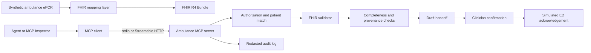

# MCP Ambulance Handoff Gateway Using HL7 FHIR

**Student:** Omair Gibreel

**Course:** COSC726 - Agentic Artificial Intelligence

**Project topic:** Model Context Protocol, ambulance handoff, and HL7 FHIR

## Project summary

I plan to build an MCP server that helps transfer a synthetic ambulance patient
record to a receiving emergency department in HL7 FHIR format. The project will
focus on interoperability and safety: validating the record, detecting missing
handoff information, building a structured draft, enforcing patient-level
authorization, and recording an audit trail.

The system will not diagnose a patient, recommend treatment, calculate a drug
dose, choose a destination hospital, or dispatch an ambulance. A clinician will
remain responsible for checking and confirming the handoff. All cases will be
synthetic, so no real protected health information will enter the repository,
model context, logs, or demonstration.

## The problem

Ambulance and hospital systems may represent the same event differently. A
prehospital record can contain demographics, times, vital signs, interventions,
medications, and a clinical narrative, but the receiving system needs that
information in a predictable structure. A custom integration can work for one
application while being difficult to reuse, validate, or audit.

HL7 FHIR provides standardized healthcare resources and a JSON representation
for exchanging clinical information. MCP gives an AI host a standard way to
discover server-provided tools, resources, and prompt templates. My project
combines them: FHIR standardizes the healthcare data, while MCP standardizes how
an agent accesses validation and handoff capabilities.

The project is not intended to prove that an AI model can replace a paramedic
or emergency clinician. It asks whether an MCP server can make a narrow
ambulance handoff workflow more interoperable, complete, and auditable while
keeping safety decisions outside the model.

## Research questions

1. Can two independent MCP clients discover and use the same ambulance handoff
   capabilities without client-specific tool definitions?
2. Can an ePCR-like ambulance record be mapped into a valid HL7 FHIR R4 Bundle
   without losing important source fields or inventing clinical facts?
3. Can deterministic completeness checks identify missing handoff data more
   reliably than asking a language model to notice it?
4. Can server-side authorization, patient matching, and clinician confirmation
   prevent wrong-patient disclosure and unapproved handoff submission?
5. What latency and context-token overhead do MCP and FHIR validation add over
   direct custom JSON processing?

## Proposed workflow

1. A synthetic ambulance case is loaded from the evaluation dataset.
2. A deterministic mapper creates FHIR R4 resources and a transaction or
   document Bundle.
3. The MCP server exposes the authorized case as a resource.
4. The client calls validation and completeness tools before requesting a
   handoff draft.
5. A language model may summarize the already-grounded fields into a MIST or
   SBAR-style draft, with source references attached.
6. A simulated clinician confirmation is required before the handoff can be
   marked as sent.
7. The server records validation results, confirmation, receiving facility,
   timestamps, and provenance in a redacted audit trail.



## FHIR data model

The implementation will target the published HL7 FHIR R4 specification and use
a deliberately small profile suitable for the course project.

| FHIR resource | Use in the project |
|---|---|
| `Patient` | Synthetic identifier and limited demographics needed for matching |
| `Encounter` | Ambulance incident and transfer-of-care context |
| `Observation` | Timestamped vital signs with explicit values and units |
| `ClinicalImpression` | Paramedic working impression, clearly marked as provisional |
| `MedicationAdministration` | Medication already administered, not a recommendation |
| `Procedure` | Intervention already performed |
| `Practitioner` and `Organization` | Synthetic ambulance crew and receiving organization |
| `Location` | Incident and receiving locations using synthetic identifiers |
| `Composition` and `Bundle` | Structured handoff document and contained resources |
| `Provenance` and `AuditEvent` | Source, transformation, access, and confirmation records |

Every generated value will either point to a source field or be a documented
transformation. Missing source data will remain absent or use the appropriate
FHIR representation; the model will not fill gaps by guessing.

## MCP capabilities

### Tools

| Tool | Tier | Behaviour |
|---|---|---|
| `validate_fhir_bundle` | Read | Runs structural and project-profile validation and returns exact issues. |
| `get_ambulance_case` | Read | Returns the authorized synthetic case and its source version. |
| `check_handoff_completeness` | Read | Reports missing identity, timing, vital, intervention, and provenance fields. |
| `create_handoff_draft` | Read | Creates a grounded MIST/SBAR-style draft with evidence references. |
| `confirm_handoff` | Consequential | Marks a simulated handoff as sent only with clinician confirmation and an idempotency key. |
| `record_ed_acknowledgement` | Write | Records a simulated receiving-department acknowledgement. |

There will be no tool for diagnosis, treatment selection, medication ordering,
dose calculation, destination selection, or ambulance dispatch.

### Resources

- `ambulance://cases/{case_id}/source` - authorized synthetic source record
- `ambulance://cases/{case_id}/fhir` - mapped FHIR Bundle
- `ambulance://cases/{case_id}/validation` - current validation report
- `ambulance://cases/{case_id}/audit` - redacted audit trail
- `ambulance://profiles/handoff-r4` - project data dictionary and profile rules

### Prompts

- `prepare_mist_handoff` - draft a concise handoff from validated evidence
- `prepare_sbar_handoff` - alternate structured handoff format
- `explain_validation_failure` - explain missing or invalid fields without
  inventing replacements

The prompt templates are guidance, not security controls. The server will apply
the same validation and authorization even if a client ignores them.

## Safety, security, and privacy

- The dataset will contain synthetic patients only. No real names, addresses,
  record numbers, narratives, or images will be used.
- The authenticated server will create the patient and user scope. The model
  cannot gain access by passing `patient_id` or `role="doctor"` in an argument.
- Every read will check that the case belongs to the authorized synthetic
  tenant and current handoff session.
- Patient matching will use more than a free-text name. The evaluation will
  include similar identifiers and deliberately mismatched cases.
- Clinical narrative, FHIR text fields, and tool results will be treated as
  untrusted data because they can contain prompt injection.
- Vital values will retain timestamps and explicit units. The system will not
  silently convert or merge conflicting observations.
- A draft cannot be confirmed while required identifiers, provenance, or
  validation gates are missing.
- `confirm_handoff` will require a clinician-confirmation claim, receiving
  organization, current case version, and idempotency key. It will not accept a
  confirmation requested only by the model.
- Logs will use case and run IDs and will avoid raw patient text. Secrets and
  authorization tokens will never be committed.
- Local development will use `stdio`. Streamable HTTP tests will validate
  origins, bind locally, and use scoped test authorization.

## Evaluation dataset

I will create at least 40 synthetic ambulance cases:

- 28 normal cases covering complete and incomplete handoffs, repeated vital
  signs, administered medications, procedures, and receiving acknowledgements;
- 12 adversarial cases covering wrong-patient identifiers, missing units,
  impossible timestamps, stale case versions, duplicate confirmation, hidden
  instructions in narrative text, cross-patient access, and a request to invent
  a missing clinical fact.

Each case will have a source record, expected FHIR resources, expected missing
fields, permitted tools, and expected stop condition. A small subset will be
reviewed manually against the profile before it is used as an evaluation set.

## Experimental comparison

The same cases will be run through four configurations:

1. custom ambulance JSON processed by direct Python functions;
2. FHIR mapping and validation without MCP;
3. MCP plus FHIR schemas without patient and confirmation gates;
4. secured MCP plus FHIR with all authorization, provenance, and confirmation
   gates enabled.

The comparison will report:

- FHIR structural and project-profile validity;
- source-to-FHIR field mapping accuracy;
- missing-field detection precision and recall;
- unsupported or invented clinical fields, with a target of zero;
- wrong-patient or cross-tenant disclosures, with a target of zero;
- unconfirmed handoffs marked sent, with a target of zero;
- duplicate handoffs after retry, with a target of zero;
- correct completion and safe-block rates;
- p50 and p95 local latency;
- context tokens per case;
- capability discovery and execution from at least two MCP clients.

The model name, MCP SDK version, FHIR version, profile version, prompt version,
transport, and case-set commit will be recorded beside every result.

## Colab and reproducibility

The project will include a Google Colab notebook that installs pinned Python
dependencies, creates the synthetic cases, starts the MCP server locally, runs
the client, validates the FHIR Bundles, displays the evaluation table, and
shuts the server down cleanly. A deterministic fake model client will run every
safety test without an API key. An optional open-weight model section may be
used only for the handoff wording, not for validation or authorization.

No notebook cell will depend on a path from my own computer. A fresh Colab
runtime should be able to reproduce the deterministic results from the cloned
repository.

## Planned repository structure

```text
week05/
|-- project_proposal.md
`-- proposal_checklist.md
project/
|-- README.md
|-- requirements.txt
|-- ambulance_mcp/
|   |-- server.py
|   |-- domain.py
|   |-- fhir_mapping.py
|   |-- validation.py
|   |-- authorization.py
|   `-- audit.py
|-- data/synthetic_cases.json
|-- profiles/handoff-r4.json
|-- tests/
`-- notebooks/ambulance_mcp_colab.ipynb
```

## Schedule

| Week | Planned result |
|---|---|
| 5 | Proposal, scope, safety boundaries, and research questions |
| 6 | Synthetic ePCR schema, FHIR mapping plan, fixtures, and threat model |
| 7 | FHIR mapper, validator, and deterministic tests |
| 8 | MCP `stdio` server with tools, resources, and prompts |
| 9 | Patient-scoped authorization, confirmation gate, and audit events |
| 10 | Streamable HTTP and adversarial testing |
| 11 | Baselines, measurements, error analysis, and Colab notebook |
| 12 | Final report, reproducible release, and demonstration |

## Deliverables

- Python MCP server implementing the ambulance handoff capabilities;
- synthetic ambulance dataset and expected FHIR Bundles;
- FHIR mapping and validation rules;
- two MCP clients or one client plus the MCP Inspector;
- Colab demonstration notebook;
- automated normal, authorization, and adversarial tests;
- threat model and privacy design;
- accuracy, safety, latency, and token comparison table;
- final report and demonstration.

## Risks and fallback plan

FHIR can become too broad for one course project. I will restrict the profile
to the listed resources and fields rather than attempting a complete electronic
patient care record. If a full terminology server is unavailable, the project
will validate a documented local value set and report that limitation. If
Streamable HTTP takes too much time, the tested core will remain `stdio` and the
HTTP demonstration will stay local. If a real model is slow or unreliable, the
deterministic client will still demonstrate all protocol, validation,
authorization, and audit requirements.

The NEMSIS standard may be used as a reference for prehospital field names, but
full NEMSIS certification and a complete NEMSIS-to-FHIR implementation are out
of scope. The project will publish a small, explicit mapping table instead.

## Success criteria

The project will be considered successful when a fresh Colab runtime can run
the documented demonstration; two clients can discover the same MCP
capabilities; every generated handoff Bundle passes the declared FHIR profile;
normal cases preserve their expected source fields; missing fields are reported
without invention; cross-patient reads and unconfirmed submissions always
fail; repeated confirmation does not create duplicates; and the final report
measures what MCP and FHIR added instead of only showing that the server starts.

## References

- [HL7 FHIR R4 specification](https://hl7.org/fhir/R4/)
- [FHIR Patient resource](https://hl7.org/fhir/R4/patient.html)
- [FHIR Observation resource](https://hl7.org/fhir/R4/observation.html)
- [FHIR Encounter resource](https://hl7.org/fhir/R4/encounter.html)
- [FHIR Bundle resource](https://hl7.org/fhir/R4/bundle.html)
- [FHIR Provenance resource](https://hl7.org/fhir/R4/provenance.html)
- [FHIR AuditEvent resource](https://hl7.org/fhir/R4/auditevent.html)
- [SMART App Launch authorization guide](https://hl7.org/fhir/smart-app-launch/)
- [NEMSIS Version 3 technical resources](https://nemsis.org/technical-resources/version-3/)
- [Model Context Protocol specification](https://modelcontextprotocol.io/specification/latest)
- [Official MCP Python SDK](https://github.com/modelcontextprotocol/python-sdk)
- [MCP security best practices](https://modelcontextprotocol.io/specification/latest/basic/security_best_practices)
