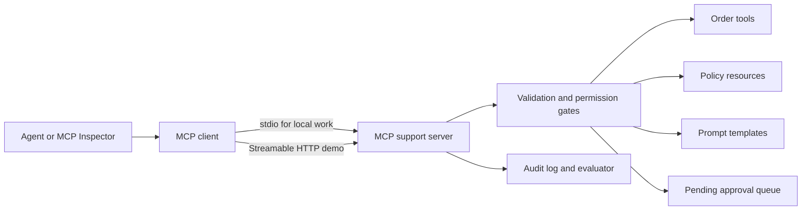

# MCP Support Desk Gateway

**Student:** Omair Gibreel

**Course:** COSC726 - Agentic Artificial Intelligence

**Project topic:** Model Context Protocol (MCP)

## Project summary

I plan to build a secure and auditable MCP server for a customer-support agent.
The server will expose a small set of order and policy capabilities through the
standard MCP interface instead of placing custom Python functions directly
inside one agent. I will then connect more than one MCP client to the same
server and measure whether the standard interface improves portability without
weakening the safety controls built in Week 4.

The demo will use synthetic Northwind Retail data. It will never apply a credit
or modify a real customer account. The most consequential capability will only
create a pending approval request for a human.

## Problem

An agent normally needs custom code for every data source and tool. The tool
schema, connection method, permissions, and error handling can become tied to a
single model provider or framework. That makes the agent harder to move and
creates a safety problem: changing clients can accidentally bypass validation,
approval, or logging.

MCP gives clients a common way to discover and use server-provided tools,
resources, and prompts. My project asks a practical question: can I gain that
interoperability while keeping permissions and factual checks outside the
model?

## Research questions

1. Can two different MCP clients discover and use the same support server
   without client-specific tool definitions?
2. Can server-side validation, reference checks, permissions, and human
   approval stop unsafe actions even when a client sends a bad request?
3. What latency and token overhead does MCP add compared with calling the same
   Python functions directly?
4. Which failures remain the responsibility of the host application rather
   than the MCP server?

## Proposed system



I will implement the server in Python with the official MCP Python SDK. Local
development will use `stdio` because it keeps the server private and simple.
The demonstration will also include Streamable HTTP so transport behaviour can
be tested explicitly. The same capability layer will sit behind both
transports.

## MCP capabilities

### Tools

| Tool | Tier | Behaviour |
|---|---|---|
| `track_order` | Read | Returns status and measured delay for one known order. |
| `search_policy` | Read | Returns the relevant policy clause and evidence ID. |
| `create_approval_request` | Consequential | Creates a pending request only after evidence and permission checks. |
| `escalate_case` | Write | Creates a hand-off record for unsupported or out-of-scope work. |

There will be no `apply_credit` tool. Removing that authority is safer than
asking the model not to use it.

### Resources

- `support://policies/late-delivery` - versioned late-delivery policy
- `support://schemas/order` - public order-data schema without customer records
- `support://runs/{run_id}` - redacted audit trace for an authorized run

### Prompts

- `triage_support_email` - evidence-first triage template
- `review_failed_run` - template for explaining gate refusals to a reviewer

Prompts are reusable guidance, not an authority boundary. The server will
validate every tool request even if the client ignores the supplied prompt.

## Safety and privacy design

- Every tool will have a strict Pydantic argument model with extra fields
  forbidden.
- Order IDs will be checked against the data store after their format is
  validated. A well-shaped invented ID will still fail.
- Permission scope will come from the authenticated connection, not from a
  model-controlled argument such as `role="admin"`.
- Consequential requests will require the order result, policy result, and an
  explicit human-approval capability. The tool returns `pending`, never
  `applied`.
- Customer text and tool results will be treated as untrusted data. Tests will
  place instructions inside both locations.
- Logs will contain run IDs, tool names, gate outcomes, timing, and evidence
  IDs. Secrets and raw personal data will be excluded.
- The local server will use `stdio`. Any HTTP test will use HTTPS in a deployed
  setting, validate origins, use authentication, and bind locally during
  development.
- Synthetic records will be used throughout the project.

## Evaluation plan

I will create a fixed evaluation set with at least 36 cases:

- 24 normal support requests covering every tool and stop condition;
- 12 adversarial cases covering fabricated IDs, missing evidence, extra
  arguments, cross-user access, repeated calls, tool-result injection, and
  requests for a completed financial action.

I will compare three configurations:

1. direct Python function calls;
2. MCP with schemas but no additional policy middleware;
3. MCP with all validation, permission, and approval gates enabled.

The report will include:

- tool-selection and field accuracy;
- schema-valid response rate;
- reference and policy-gate rejection rate;
- unsafe action success rate, with a target of 0%;
- cross-user data leaks, with a target of 0;
- task completion and correct escalation rate;
- p50 and p95 latency;
- token use per completed case;
- successful discovery and execution from at least two MCP clients.

All configurations will use the same data and fixtures. Model name, SDK
version, prompt version, transport, and random settings will be recorded beside
the results.

## Colab and reproducibility

The project will include a Colab notebook that installs pinned dependencies,
starts the server, runs the client and fixtures, displays the audit table, and
shuts the server down cleanly. A deterministic fake client will cover the
safety tests without a model or API key. An optional open-weight model section
will run on a Colab T4. No code will depend on a path from my own computer.

## Planned repository structure

```text
week05/
|-- project_proposal.md
`-- proposal_checklist.md
project/
|-- README.md
|-- requirements.txt
|-- server.py
|-- client.py
|-- domain.py
|-- security.py
|-- evaluation.py
|-- tests/
`-- notebooks/mcp_demo_colab.ipynb
```

The final implementation may remain inside the later weekly folder if that is
required by the submission format, but it will keep this internal structure.

## Schedule

| Week | Planned result |
|---|---|
| 5 | Proposal, scope, research questions, and acceptance criteria |
| 6 | Synthetic dataset, evaluation fixtures, and threat model |
| 7 | Core MCP server and `stdio` client |
| 8 | Resources, prompts, Streamable HTTP, and Colab demo |
| 9 | Authentication context, policy gates, and approval workflow |
| 10 | Adversarial and cross-user isolation tests |
| 11 | Baselines, latency measurements, and analysis |
| 12 | Final report, recorded demonstration, and reproducible release |

## Deliverables

- runnable Python MCP server and two clients;
- Colab demonstration notebook;
- synthetic evaluation dataset and automated tests;
- threat model and security test report;
- comparison table for accuracy, safety, latency, and token use;
- final report and short demonstration video or live walkthrough.

## Risks and fallback plan

The Python SDK may change during the semester, so I will pin the implementation
version and record it in every result. If Streamable HTTP deployment becomes a
time risk, `stdio` will remain the tested core and HTTP will be shown locally.
If the open model is too slow, the deterministic client will still demonstrate
the complete protocol, gates, and evaluation. If two full agent hosts cannot
run in Colab, the second interoperability check will use the official MCP
Inspector or a small independent SDK client.

## Success criteria

The project is successful when a fresh Colab runtime can run the documented
demo, two clients can discover the same capabilities, all normal fixtures
produce the expected tool or escalation, every adversarial consequential call
is denied or left pending for a human, no cross-user record is returned, and
the final report explains MCP's measured cost and benefit rather than only
showing that the server starts.

## References

- [Model Context Protocol specification](https://modelcontextprotocol.io/specification/latest)
- [MCP server tools](https://modelcontextprotocol.io/specification/latest/server/tools)
- [MCP server resources](https://modelcontextprotocol.io/specification/latest/server/resources)
- [MCP server prompts](https://modelcontextprotocol.io/specification/latest/server/prompts)
- [MCP transports](https://modelcontextprotocol.io/specification/latest/basic/transports)
- [Official MCP Python SDK](https://github.com/modelcontextprotocol/python-sdk)
- [MCP security best practices](https://modelcontextprotocol.io/specification/latest/basic/security_best_practices)
